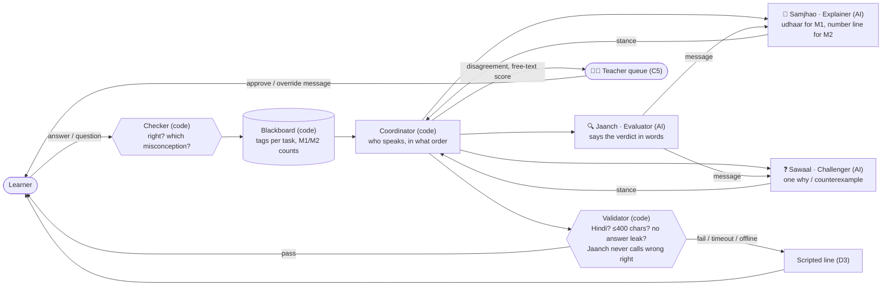
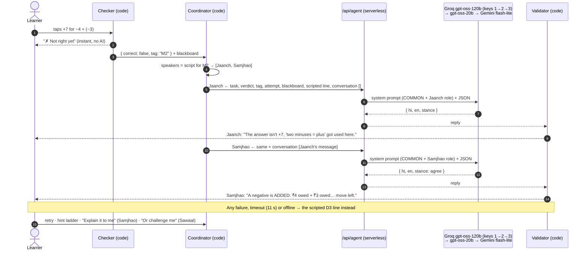
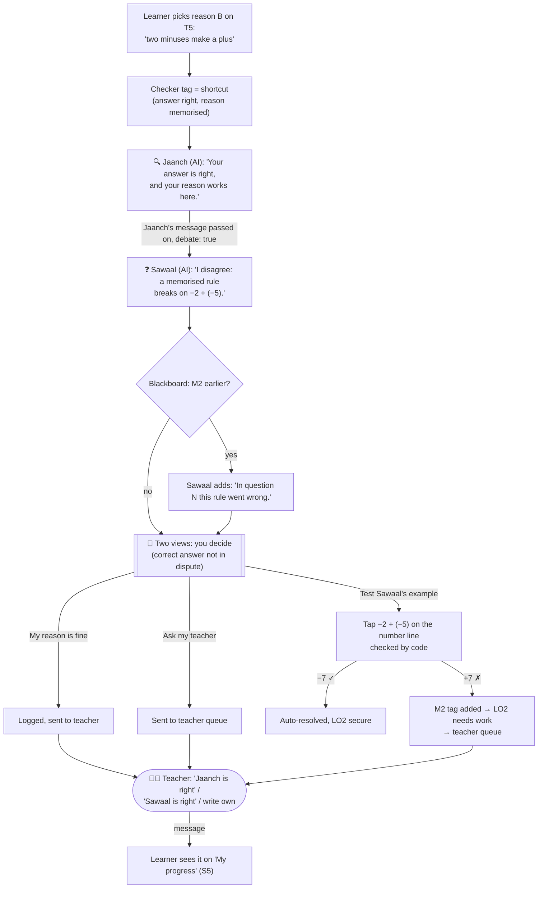
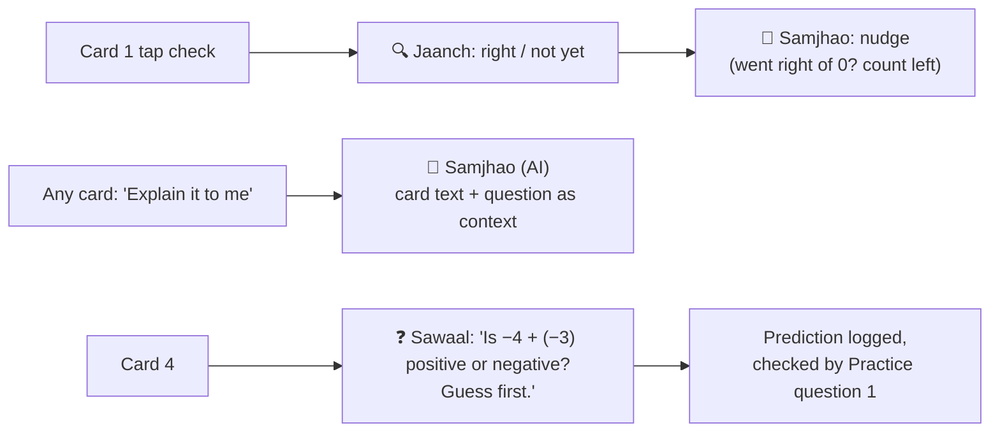

# Ganit Chaupal: how the AI agents are orchestrated

Code decides correctness. Three AI agents (Jaanch, Samjhao, Sawaal) only phrase, explain and challenge. A coordinator
(code) decides who speaks, passes each agent's message to the next, checks every AI line, and falls back to a
script written in advance. The teacher has the final word. Full specification: [REPORT.md D6](../REPORT.md).

## 1. Who does what

## 2. One answer in Practice (S3), step by step

## 3. The disagreement moment (S4, question 5)

## 4. Agents on the Learn screen (S2)

## How the agents exchange information

| Channel | What passes | Where in code |
|---|---|---|
| Conversation | Each agent's reply is sent to the next agent (last 4 turns) | `speak()` in `Practice.jsx`, `TwoViews.jsx` |
| Blackboard | Learner's misconception history across all questions | `blackboard()` in `src/agents.js` |
| Stance | `agree` / `disagree` with the previous agent, shown on the bubble | `api/agent.js` → `Bubble.jsx` |
| Debate flag | Jaanch's verdict is handed to Sawaal, who must challenge it | `TwoViews.jsx` |
| Teacher queue | Disagreements and free-text scores → teacher → message to learner | `store.addReview`, `Teacher.jsx`, `reviews` table |
